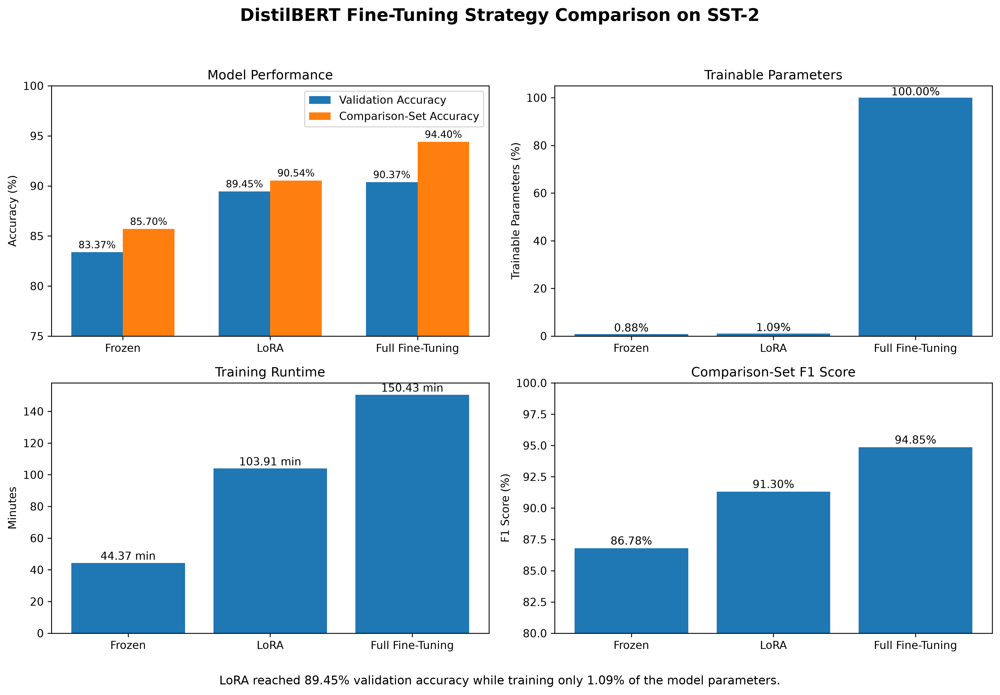

# Pretrained Transformers and Parameter-Efficient Fine-Tuning

This section of the repository explores how pretrained transformer models can be adapted to a downstream NLP task using different fine-tuning strategies.

The experiments use **DistilBERT** on the **SST-2 sentiment classification dataset** and compare three approaches:

1. Frozen feature extraction
2. Full fine-tuning
3. LoRA parameter-efficient fine-tuning

The goal was not only to maximise classification performance, but also to understand the trade-off between model performance, trainable parameters, and training time.

---

## Experiment Progression

I started by exploring how a pretrained DistilBERT model tokenises text and produces contextualised token representations.

The experiments then progressed through:

- Subword tokenisation with DistilBERT
- Contextual embeddings
- Pretrained sentiment classification
- Training a custom classification head
- Frozen DistilBERT fine-tuning
- Full model fine-tuning
- LoRA parameter-efficient fine-tuning

This progression helped connect transformer concepts such as tokenisation, contextual embeddings, attention projections, transfer learning, and low-rank adaptation to an actual training workflow.

---

## Dataset

The experiments use the **Stanford Sentiment Treebank (SST-2)** dataset through the GLUE benchmark.

The labelled training data was split using a fixed random seed and stratification:

| Split | Examples |
|---|---:|
| Training | 60,614 |
| Validation | 872 |
| Comparison set | 6,735 |
| Official SST-2 test | 1,821 |

The same training and evaluation splits were used across the three approaches to make the comparison as consistent as possible.

The official SST-2 test labels are hidden for benchmark evaluation, so the 6,735-example labelled split was used as a local comparison set.

---

## Fine-Tuning Strategies

### 1. Frozen DistilBERT

The pretrained DistilBERT backbone is frozen while the classification layers are trained for sentiment classification.

This preserves the pretrained language representations while requiring relatively few trainable parameters.

**Trainable parameters:** 592,130  
**Trainable percentage:** 0.88%

---

### 2. Full Fine-Tuning

All DistilBERT parameters are allowed to update during sentiment training.

This gives the model maximum flexibility to adapt its pretrained representations to SST-2, but requires substantially more parameter updates and computation.

**Trainable parameters:** 66,955,010  
**Trainable percentage:** 100%

A learning rate of `2e-5` was used to avoid making excessively large updates to the pretrained weights.

---

### 3. LoRA

Low-Rank Adaptation (LoRA) keeps the original DistilBERT parameters frozen and introduces small trainable low-rank matrices into selected transformer components.

For this experiment, LoRA was applied to the query and value projections of DistilBERT's attention layers.

Configuration:

```python
LoraConfig(
    r=8,
    lora_alpha=16,
    target_modules=["q_lin", "v_lin"],
    lora_dropout=0.1,
    bias="none",
    modules_to_save=["pre_classifier", "classifier"],
)
```

**Trainable parameters:** 739,586  
**Trainable percentage:** 1.09%

This allows the model to adapt its attention behaviour without updating the complete pretrained model.

---

## Results

| Method | Trainable Parameters | Trainable % | Best Validation Accuracy | Comparison Accuracy | Precision | Recall | F1 | Training Time |
|---|---:|---:|---:|---:|---:|---:|---:|---:|
| Frozen | 592,130 | 0.88% | 83.37% | 85.70% | 89.58% | 84.16% | 86.78% | 44.37 min |
| LoRA | 739,586 | 1.09% | 89.45% | 90.54% | 93.75% | 88.98% | 91.30% | 103.91 min |
| Full Fine-Tuning | 66,955,010 | 100% | 90.37% | 94.40% | 97.50% | 92.33% | 94.85% | 150.43 min |

---

## Visual Comparison



---

## Key Finding

LoRA achieved **89.45% validation accuracy**, compared with **90.37% for full fine-tuning**, a difference of only **0.92 percentage points**.

However, LoRA trained only **739,586 parameters (1.09%)**, while full fine-tuning updated **66,955,010 parameters (100%)**.

That means LoRA used approximately **90x fewer trainable parameters** while retaining most of the validation performance of full fine-tuning.

The experiments also demonstrate that parameter efficiency does not translate directly into equivalent wall-clock speed improvements. LoRA still requires forward computation through the pretrained transformer and gradient propagation through the network to its adapters.

---

## Overfitting and Checkpoint Selection

Both the full fine-tuning and LoRA experiments showed signs of overfitting after the first epoch.

For LoRA:

| Epoch | Training Loss | Validation Loss | Validation Accuracy |
|---|---:|---:|---:|
| 1 | 0.2923 | 0.2695 | 89.45% |
| 2 | 0.2344 | 0.2647 | 89.33% |
| 3 | 0.2082 | 0.2653 | 89.11% |

Although training loss continued to decrease, validation accuracy did not improve.

The training pipeline therefore saves the checkpoint with the highest validation accuracy rather than automatically using the final epoch.

---

## What I Learned

This experiment helped demonstrate several important ideas in modern NLP:

- Pretrained language models can transfer general language representations to downstream tasks.
- Freezing a pretrained backbone provides a computationally cheaper baseline but limits task-specific adaptation.
- Full fine-tuning provides the strongest performance in this experiment but requires updating every model parameter.
- LoRA provides a strong middle ground between frozen feature extraction and full fine-tuning.
- The number of trainable parameters and actual training runtime are different measures of efficiency.
- Validation performance is more useful than training loss for selecting a model that generalises.
- Learning rate becomes especially important when modifying pretrained model weights.

---

## Files

| File | Purpose |
|---|---|
| `pretrained_transformer.py` | Explores DistilBERT tokenisation and contextual representations |
| `sentiment_classifier.py` | Uses a pretrained SST-2 sentiment classifier |
| `fine_tune_sentiment.py` | Introduces custom sentiment fine-tuning |
| `real_sentiment_training.py` | Trains the frozen DistilBERT baseline on SST-2 |
| `evaluate_frozen_model.py` | Evaluates the frozen baseline |
| `full_finetune_sentiment.py` | Performs full DistilBERT fine-tuning |
| `inspect_distilbert.py` | Inspects DistilBERT linear layers and attention projections |
| `lora_sentiment_training.py` | Trains LoRA adapters for sentiment classification |
| `create_comparison_chart.py` | Generates the experiment comparison visualisation |
| `results/experiment_results.csv` | Stores metrics from all three experiments |
| `results/model_comparison.png` | Visual comparison of the experiments |

---

## Tools

- Python
- PyTorch
- Hugging Face Transformers
- Hugging Face Datasets
- PEFT / LoRA
- scikit-learn
- Matplotlib

---

## Next Steps

Future experiments can extend this comparison by exploring:

- Different LoRA ranks
- Different LoRA target modules
- Learning-rate sensitivity
- Adapter placement across transformer layers
- LoRA versus other parameter-efficient fine-tuning methods
- Error analysis on incorrectly classified reviews
